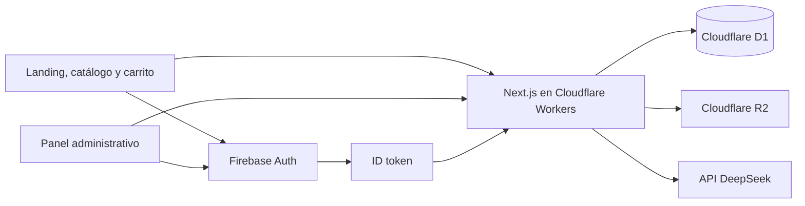

# Coctels OPS: Cloudflare, catálogo y Opsy Bot

Fecha: 2026-10-18. Estado: propuesta concreta para revisión del operador; implementación pendiente.

## Resultado solicitado

Gestionar todos los productos desde el panel, presentar la carta del Canva en la tienda, alojar la aplicación y todos los datos operativos en Cloudflare, conservar Firebase exclusivamente para autenticación y reemplazar el sugeridor por un chat Opsy Bot con DeepSeek. La mascota de referencia es el panda aportado por el operador.

Se conserva la aplicación Next.js existente y sus rutas, carrito, checkout, cuentas, pedidos y controles administrativos. La propuesta incluye migrar todos los módulos operativos, no solamente el catálogo. La puesta en producción y las escrituras remotas son una fase separada que requiere la confirmación explícita indicada en AGENTS.md.

## Evidencia revisada

- Repositorio local con cambios anteriores sin confirmar. Deben preservarse; no restaurar archivos ni reconstruir desde HEAD perdiéndolos. No había grafo Graphify disponible.
- Panel existente en `src/app/admin/productos/`, categorías en `src/app/admin/categorias/`, formulario `src/components/admin/ProductForm.tsx` y API protegida en `src/app/api/admin/`.
- Diez repositorios en `src/lib/firestore/`, más consultas directas en autorización, reportes, estadísticas y límite de IA.
- Firebase Firestore se inicializa también en cliente; los hooks de documentos/colecciones no tienen consumidores encontrados.
- Carta [CARTA COCTEL´S OPS 2025](https://www.canva.com/design/DAGH-niw4JE/k5gQ3oLt677WeTMFQouJYQ/edit), siete páginas leídas en la sesión de Chrome del operador. Es la fuente comercial solicitada, aunque el título indique 2025.
- El manifiesto local ignorado `scripts/catalog/products.json` contiene cinco productos distintos de la carta; no debe tratarse como su transcripción.
- La referencia adjunta de Opsy está visible en la conversación. No se encontró un archivo de mascota en `public/`. La referencia pública de Sarin Bot no pudo inspeccionarse por fallo de lectura del navegador; no se presupone acceso a su configuración privada ni se promete una réplica exacta.

## Alternativas y decisión propuesta

| Ruta | Consecuencia | Decisión |
| --- | --- | --- |
| Next.js mediante OpenNext en Workers, D1 y R2 | Conserva el framework y las rutas; exige adaptar persistencia y verificar en workerd | Recomendada |
| vinext en Workers, D1 y R2 | Cloudflare lo recomienda actualmente, pero está en beta y cambia la implementación del framework | Evaluar después; evitar sumar esa migración al cambio de datos |
| Exportación estática en Pages y API separada | Divide despliegues y exige rehacer renderizado/contratos de esta aplicación con servidor | Descartada para este alcance |

La elección de OpenNext es una decisión de este proyecto. La guía actual de Cloudflare recomienda vinext y mantiene otras rutas; OpenNext documenta soporte de Next.js 16. Ese soporte declarado no sustituye compilar y probar esta versión exacta, 16.3.8, en Workers. Se fijarán versiones compatibles en el lockfile después de verificar metadatos y auditoría de dependencias. Fuentes: [Cloudflare Next.js](https://developers.cloudflare.com/workers/framework-guides/web-apps/nextjs/), [OpenNext Cloudflare](https://opennext.js.org/cloudflare).

## Arquitectura

- Un solo despliegue de aplicación con módulos internos claros. Los componentes cliente acceden a la API; nunca a D1 ni a secretos.
- D1 contiene perfiles, direcciones, roles, permisos, productos, categorías, pedidos, promociones, inventario, notificaciones, auditoría, configuración y controles de consumo del chat.
- R2 contiene imágenes del catálogo, mascota y, si se solicita durante el corte, exportaciones privadas de respaldo. Los respaldos no se guardan en un bucket público.
- Firebase conserva identidades, login, recuperación, verificación de correo y custom claims. Perfiles y permisos operativos se resuelven desde D1.
- No se crean cuentas ni recursos remotos durante la implementación local. Los identificadores reales de D1 y R2 se configuran cuando se prepare el despliegue autorizado.

## Persistencia e integridad

Crear una capa de repositorios D1 en `src/lib/db/`; conservar contratos de dominio y trasladar consumidores desde `src/lib/firestore/`. Separar acceso a bindings de las consultas para probar ambos. Retirar `getAdminDb` de la aplicación final y la inicialización/hooks de Firestore del cliente. Firebase Admin queda exclusivamente en herramientas Node que administran Auth o exportan el origen durante la migración.

Modelo propuesto:

| Dominio | Tablas |
| --- | --- |
| Identidad operativa | `users`, `user_addresses`, `roles`, `user_roles`, `role_permissions` |
| Catálogo | `categories`, `products`, `product_sizes`, `product_flavors`, `product_add_ons`, `product_base_options` |
| Pedidos | `orders`, `order_items`, `order_status_history` |
| Promociones | `promotions`, `promotion_products`, `promotion_categories` |
| Operación | `inventory_movements`, `notifications`, `audit_entries` |
| Configuración | `store_configuration`, `business_hours`, `delivery_zones` |
| Chat y migración | `chat_rate_limits`, `chat_usage_daily`, `migration_runs` |

Se mantienen IDs y Firebase UID existentes; las nuevas entidades pueden usar UUID. Las imágenes usan claves de almacenamiento independientes y seguras para IDs históricos con mayúsculas. No se renumeran productos referenciados en pedidos.

Fechas en UTC; presentación `es-CO`. Contrato monetario único: formularios y API expresan COP con máximo dos decimales; D1 persiste enteros en centavos de COP (escala 100), dentro de rango seguro. Convertir mediante representación decimal validada, sin redondeos implícitos de coma flotante. Aplicar la misma escala a precios base/por tamaño, adiciones, incrementos por base, descuentos fijos, mínimos/máximos, costos de envío, subtotales y totales. Los porcentajes son magnitudes separadas, nunca centavos. Antes de migrar, comprobar precisión/rango histórico: si existen importes con más de dos decimales, detener el corte y emitir informe privado revisable para acordar una representación exacta o transformación explícita, conservando el original en el respaldo. No truncar, omitir registros ni recalcular importes de pedidos históricos. Conservar snapshots de artículo, precio, dirección y personalización en los pedidos; JSON es adecuado para snapshots inmutables y cambios de auditoría, no para las relaciones de roles.

Índices derivados de las consultas reales: pedidos por cliente/fecha y estado/fecha; notificaciones por propietario o audiencia/fecha; usuarios por tipo/activo y pertenencia a roles; inventario/auditoría por fecha; promociones por código/fecha; catálogo por categoría/activo/orden. Detectar códigos promocionales duplicados antes de imponer unicidad. Pedidos históricos sin cliente o con productos eliminados deben poder conservarse sin falsificar referencias.

Cada pedido debe crear atómicamente orden, detalle, historial, descuento de stock, uso de promoción, movimientos, notificación y auditoría. Mantener la idempotencia por UID y clave, rechazando la misma clave con un payload diferente. Actualizar estados y ajustes de inventario con sus auditorías en el mismo límite atómico.

En D1, usar batches transaccionales y condiciones SQL que fallen si una precondición no se satisface. Un `UPDATE` de cero filas no aborta por sí mismo: la validación no puede quedar después del commit en JavaScript. La implementación debe demostrar con pruebas concurrentes que la última unidad y el último cupón se consumen una sola vez, y que un fallo de auditoría revierte todo. [D1 batch](https://developers.cloudflare.com/d1/worker-api/d1-database/).

No aplicar cascadas que borren historial ni vacíen el alcance de una promoción convirtiéndola en global. Categorías referenciadas requieren reasignación o desactivación. Retirar productos del catálogo conserva sus snapshots históricos.

## Firebase solamente para autenticación

Mantener `verify-request.ts` como entrada de autorización. Verificar el JWT Firebase con una implementación compatible con Workers, usando las claves públicas oficiales y validaciones de algoritmo, firma, `kid`, audiencia, emisor, sujeto y tiempos. Caché de claves según cabeceras del emisor, con renovación ante `kid` desconocido; nunca aceptar un token sin verificar porque la descarga de claves falló. No introducir credenciales Firebase Admin en el Worker para leer Firestore.

Después de verificar el token, buscar perfil activo en D1. Administrador requiere claim `admin === true` y perfil `accountType === "admin"`; staff recibe permisos de roles activos. Conservar la compra con correo verificado, propiedad por UID, filtros de información en respuestas de cliente, protección de cambios propios y del último administrador. La comprobación de revocación de token no estaba activada en `verifyIdToken` actual; no afirmar que existía ni degradar su validación criptográfica. [Verificación oficial Firebase](https://firebase.google.com/docs/auth/admin/verify-id-tokens).

Adaptar `scripts/set-admin.ts` para coordinar claims Firebase y perfil D1, con compensación/reportes si falla una mitad. Mantener este flujo fuera del navegador público.

## Panel para toda la carta

Ampliar las rutas existentes, sin duplicar otro panel:

- Listado con fotografía, nombre, categoría, precio desde, stock, activo/destacado; búsqueda y filtros por categoría, visibilidad y stock. Paginación desde API cuando el tamaño lo requiera.
- Crear, editar, desactivar y retirar productos; duplicación como borrador opcional después del flujo principal. Acciones según permisos actuales.
- Categorías dinámicas desde D1, con ID coherente en formulario, API y filtros del catálogo. Validar referencia al guardar y controlar categorías inactivas.
- Tamaños configurables con etiqueta, volumen opcional y precio explícito por producto. Productos de tamaño único muestran una sola presentación. El precio desde corresponde al mínimo de las presentaciones comprables.
- Borradores con precio desconocido admiten precio ausente/null; permanecen inactivos, no destacados y no comprables. Publicar requiere al menos una presentación con precio positivo válido y datos completos. Nunca importar un cero o un precio ficticio para pasar la validación.
- Sabores, bases y adiciones mediante filas editables, sin pedir sintaxis con comas y dos puntos. Combinaciones con y sin licor son opciones explícitas; no presentar una bebida alcohólica como si fuera sin licor. Grupos con obligatoriedad y mínimo/máximo: un tamaño, un sabor cuando haya sabores, una base cuando corresponda; adiciones opcionales con una unidad por opción, salvo cantidad explícita configurada por el operador. No permitir mezclar sabores por defecto. Los cuatro toppings incluidos son descripción hasta conocer sus reglas; no habilitar cuatro selecciones arbitrarias ni mezclarlas con extras pagados.
- Imagen por archivo al crear y editar, con preview, validación real JPEG/PNG/WebP hasta 5 MB y reintento. Mantener URL permitida como alternativa. Si falla la imagen, mostrar si los demás datos se guardaron; no dejar un éxito ambiguo.
- La edición de texto/precio no sobrescribe stock que cambió desde checkout. Stock inicial solo en alta; ajustes posteriores mediante movimiento con motivo y auditoría.
- Imágenes R2 con claves propias versionadas y compensación en fallos. No eliminar objetos referenciados; limpieza posterior controlada de objetos huérfanos.
- Corregir tokens de tema del panel para eliminar texto blanco sobre formularios blancos. Mantener controles legibles, foco y funcionamiento móvil.

El cliente manda IDs de opciones y cantidades. El servidor vuelve a leer y valida precio, disponibilidad, tamaño, sabor, base, adiciones y stock. Se retiran los multiplicadores globales `0.8 / 1 / 1.3`; pedidos históricos conservan sus importes. Los carritos guardados con formato antiguo deben invalidarse o actualizarse con aviso de revisión antes de pagar.

## Carta de Canva: hechos comprobados y tratamiento

Precios observados en COP, usados como fuente solicitada para el catálogo inicial. No se inventan precios que la carta no publica.

| Familia / artículo | Presentaciones y precios observados |
| --- | --- |
| Granizados OPS | 8 oz $10.000; 16 oz $15.000; 24 oz $25.000 |
| Cremoso OPS, granizado de Baileys | 8 oz $12.000; 16 oz $17.000; 24 oz $27.000 |
| Malteadas de chocolate y Oreo | 14 oz $15.000 cada una |
| Frappé de café | 14 oz $12.000 |
| Frappé Milo loco | 14 oz $15.000 |
| Michelada sencilla / cerveza Like / saborizada | $8.000 / $8.000 / $10.000 |
| Michelada sencilla envenenada / extra envenenada | $12.000 / $16.000 |
| Michelada frutal / envenenada / extra envenenada | $12.000 / $16.000 / $20.000 |
| Soda sencilla / chamoy / saborizada | $5.000 / $6.000 / $7.000 |
| Micheladas de Like | $8.000 |
| Jugos en agua o leche | $7.000 |
| Limonadas | $9.000 |
| Papas naturales, limón, pimienta limón, BBQ y mayonesa | $4.500 cada una |
| Cervezas Águila Light, Águila Original, Pilsen, Andina latón grande | $5.000 cada una |
| Coca-Cola 250 ml / Gatorade / Bretaña 1,5 l | $2.500 / $5.000 / $7.000 |
| Cuarto, media y litro de aguardiente o ron Viejo de Caldas | Precio ausente en página 6; preparar borradores inactivos para completar desde el panel |

Sabores y bases observados:

- Granizados con licor: melón–tequila, margarita–vodka, Bombombun–tequila, sandía–vodka, Blueberry Magnetic–tequila y Sparkies–tequila. En la columna también aparece mango biche con trozos de mango sin indicar licor; su clasificación queda para completar y no debe activarse con una suposición. Sin licor: mango biche y Bombombun.
- Granizados incluyen cuatro toppings; extras Oka Loka, mini chicles, gomitas en aros x3, Bombonbum rojo, súper hiper ácido, gomita piramidal y gusanitos x3 a $1.000; la jeringa $3.000. La elección de toppings incluidos y la composición de la jeringa no se detallan: no se venden como una elección ilimitada ni se atribuyen ingredientes no publicados.
- Cremoso incluye topping; chantillí aparece a $1.000 y $2.000 sin regla de presentación: opciones separadas con nombre claro que el operador completa. Lluvia/salsa de chocolate y barquillo $1.000; pirulito de leche $500.
- Micheladas frutales: cereza, mango biche, sandía, maracuyá y maracumango; bases Águila Light, Águila Original, Pilsen o soda. La carta no define composición de envenenada/extra: conservar nombre/precio y no inventar receta.
- Sodas saborizadas: cereza, mango biche, sandía, maracuyá, maracumango y fresa. Like: limón, blueberry, frutos rojos, manzana verde.
- Jugos: mango, frutos rojos, guanábana, maracuyá, mora y fresa. Limonadas: cereza, coco limón y limón.

Transcribir a un manifiesto validado, con página de origen y estado de revisión por registro. Obtener las fotografías reales de Canva o de los originales del operador antes de asignarlas: los PNG locales de cinco sabores no demuestran correspondencia con toda la carta. Imágenes pendientes usan un placeholder honesto. No sustituir productos existentes por coincidencia de nombre: reconciliar IDs y generar diff de altas/cambios/desactivaciones en dry-run.

## Landing y experiencia móvil

Identidad existente: negro, magenta y cian, incorporando violeta del panda de referencia. Mantener la tipografía de marca disponible y fuentes de cuerpo legibles. La carta sirve como referencia visual y comercial; la aplicación actual sirve como referencia de interacción. No crear una nueva identidad genérica.

Jerarquía: título directo de OPS y acción de ver carta/pedir, imagen de Opsy contenida, productos reales destacados, acceso por categorías y datos concretos de domicilio/local. Reducir el bloque inicial de 85vh para mostrar productos pronto en móvil. Reutilizar `ProductCard`, `ProductCatalogBrowser`, `ProductCustomizer`, carrito y checkout.

No añadir antetítulos decorativos, emojis de relleno, tarjetas repetidas con iconos ni afirmaciones inventadas de popularidad. Precios COP y presentaciones visibles; estados vacíos y agotados claros; navegación por teclado; controles de categoría con estado accesible; contraste legible y respeto a movimiento reducido. Evitar autoplay innecesario.

WhatsApp sigue viniendo de la configuración central. La carta muestra 324 5545530, dirección Carrera 37 #66 D 36, Villa Hermosa e Instagram COCTELS_OPS: conservar como evidencia, sin sobrescribir silenciosamente una configuración vigente distinta. No afirmar abierto ahora ni disponibilidad en plataformas de reparto sin datos operativos que lo respalden.

## Opsy Bot

Chat flotante con el panda, nombre Opsy Bot, saludo breve y accesos a ver carta, consultar precios, opciones sin licor y domicilio. Panel compacto en escritorio y cómodo en móvil; cierre, teclado, envío con Enter y salto con Shift+Enter, estado de respuesta, error recuperable y reiniciar conversación. La mascota no ocupa el área de lectura de mensajes.

Endpoint servidor `POST /api/chat` con historial limitado y roles únicamente `user`/`assistant`. El servidor construye sus instrucciones y añade productos activos, presentaciones, precios y configuración pública desde D1. DeepSeek ayuda a explorar la carta; no inventa precios, stock ni recetas, no consulta información privada ni cambia pedidos, inventario o permisos. Las sugerencias contienen enlaces/IDs de productos existentes que la API valida. Se permite derivar a WhatsApp con el número configurado.

Las preguntas de catálogo usan contexto público; no enviar nombres, teléfonos, direcciones ni historial de compra de clientes al proveedor. Aviso breve en el chat de que las respuestas se procesan con DeepSeek y de evitar datos personales. No persistir conversaciones en servidor por defecto: historial en memoria de la pestaña con botón para limpiar. No renderizar HTML del modelo ni enlaces arbitrarios ejecutables.

Llamada HTTPS desde Worker con `DEEPSEEK_API_KEY`. Modelo configurable; candidato actual `deepseek-flash`, con `thinking` desactivado para respuestas breves y costo controlado. Confirmar disponibilidad en la cuenta con una prueba explícita al configurar la clave. Manejar respuesta inválida, timeout, 401, 429 y 5xx con mensaje útil; no mostrar credenciales, prompts internos ni cuerpo crudo del proveedor. Usar cancelación real con AbortController. [DeepSeek modelos](https://api-docs.deepseek.com/quick_start/pricing/), [thinking](https://api-docs.deepseek.com/guides/thinking_mode/).

Límites propuestos: 1.000 caracteres por mensaje, 12 mensajes de historial con tope total, 512 tokens de salida, timeout total 10 segundos. Mantener inicialmente 5 solicitudes por identidad cada 10 minutos con contador atómico en D1. Identidad servidor mediante HMAC de IP confiable en producción y secreto privado; nunca aceptar una IP arbitraria del cliente para eludir el límite. Añadir tope diario global de 1.000 solicitudes configurable; reservar cupo antes de llamar al proveedor. Sin clave o sin controles de consumo disponibles, el chat ofrece carta/WhatsApp sin hacer llamadas facturables.

Se retira `/ai-suggest`, enlaces del Header/Footer, flujo Genkit, configuración Google AI y dependencias que queden sin uso; la ruta anterior redirige a una entrada estable de Opsy. No se conserva un generador de mezclas inventadas bajo otro nombre. El límite exacto se persiste en D1: el binding nativo de rate limit no reemplaza un contador global exacto. [Límites Workers](https://developers.cloudflare.com/workers/runtime-apis/bindings/rate-limit/).

## Dónde colocar la API de DeepSeek

La implementación dejará una plantilla de variables y una guía con dos ubicaciones:

1. Desarrollo: `DEEPSEEK_API_KEY=...` en `.env.local` para Next local, o `.dev.vars` para preview de Wrangler, según el comando usado. No duplicar ni versionar valores reales. `.dev.vars*`, `.wrangler/` y `.open-next/` deben añadirse a `.gitignore` antes de crear secretos locales.
2. Producción: Cloudflare → Worker de Coctels OPS → Settings → Variables and Secrets → Add → tipo Secret → nombre `DEEPSEEK_API_KEY`. Configurar por separado preview y producción. No usar prefijo `NEXT_PUBLIC_`.

`DEEPSEEK_MODEL`, `CHAT_DAILY_REQUEST_LIMIT` y nombres de bindings pueden ser configuración normal. `CHAT_RATE_LIMIT_SECRET` es secreto. La aplicación informa disponible/configuración pendiente sin devolver ni registrar la clave. No hace falta pegar la clave en este chat ni guardarla en un formulario público.

## Migración, despliegue y reversión

Preparar herramientas con dry-run predeterminado, destino explícito e informe de errores sin datos privados. La aplicación final no tendrá fallback operativo a Firestore.

1. Exportar las once colecciones actuales y también `orders` si existe. Consolidar `orders` y `pedidos` por ID: conservar registros presentes solo en la fuente histórica, deduplicar equivalentes tras normalización y detener ante el mismo ID con contenido distinto para revisión explícita. Conservar históricos sin propietario o con productos borrados. Guardar copia privada de ambas fuentes con conteos, IDs y hashes; establecer retención inicial de 30 días, ajustable por el operador antes de extraer datos reales. Acceso limitado al operador y proceso de migración; no Git/logs/fixtures.
2. Importar primero un fixture sintético en D1 local. Probar después el export autorizado en un destino aislado; detectar faltantes, relaciones huérfanas, decimales, duplicados y timestamps inválidos. Conservar cada rechazo en informe privado, sin descartar filas silenciosamente.
3. Comparar conteos por colección/tabla, conjunto de IDs, stock, promociones, totales e historial de pedidos, perfiles/roles, configuración y reportes. El catálogo Canva es una actualización comercial distinta: aplicar su diff después de validar la copia de datos actuales.
4. Ejecutar QA local con Auth Emulator y D1 local, más build y preview en workerd. Validar binding R2 y secretos con configuración aislada; no apuntar pruebas a recursos de producción.
5. Preparar despliegue preview y seleccionar cuenta, Worker, base D1, bucket y dominio exactos. Requiere confirmación antes de crear/desplegar o escribir remotamente, según AGENTS.md. Añadir origen final a dominios autorizados de Firebase y revisar login/verificación/recuperación.
6. Congelar escrituras del origen durante copia final y cambio de origen; no implementar doble escritura improvisada. Bloquear de forma verificable las rutas mutantes del dominio Vercel anterior y las escrituras directas permitidas por reglas Firestore; cambiar DNS no basta. Cambiar tráfico solo tras validar respaldo, importación y comprobaciones del destino. Mantener Vercel y el origen Firestore durante 30 días como respaldo con ese bloqueo activo, salvo otra ventana acordada.
7. Antes de admitir escrituras en D1, se puede volver a despliegue y origen previos y reabrirlos tras verificar que el destino no recibió operaciones. Después de admitir escrituras, la recuperación ordinaria se mantiene en Cloudflare: congelar mutaciones, conservar/exportar delta, desplegar una versión compatible con el modelo nuevo o restaurar/reconciliar D1, verificar y reabrir. Definir y probar ese artefacto de contingencia antes de abrir escrituras. El despliegue Vercel viejo no entiende categorías y tamaños nuevos: un regreso a él exigiría, además del delta, una transformación inversa probada que conserve catálogo, personalizaciones y pedidos. No prometer ese regreso sin esa preparación.
8. Cada migración de esquema incluye reversión documentada y probada. Respaldar D1 antes de cambios destructivos; Time Travel sobrescribe el estado, por lo que no sustituye reconciliar operaciones posteriores. [Time Travel](https://developers.cloudflare.com/d1/reference/time-travel/).

La aprobación de este diseño autoriza planificar e implementar localmente. No equivale a autorizar escrituras remotas, corte de tráfico, eliminación de Firestore o cierre de Vercel. Esas acciones se presentarán con destinos y respaldo concretos.

## Verificación y criterios de aceptación

- `pnpm test`, `pnpm typecheck`, `pnpm lint`, `pnpm build`; auditoría de dependencias al cambiar paquetes. Build de Cloudflare y preview real de Workers, además del servidor Next local.
- Pruebas D1 de concurrencia, idempotencia, atomicidad y rollback; stock y promociones no negativos, auditoría inseparable de mutaciones. No bastan mocks de métodos Firestore renombrados.
- Pruebas de permisos por rol/propiedad y doble condición de administrador, último administrador, cuenta inactiva, correo no verificado y JWT inválido.
- E2E con Auth Emulator y D1 local: alta/edición de producto con imagen, categoría nueva visible, tamaño/precio correcto, carrito/checkout, gestión de pedidos y reintentos.
- Comprobar todas las familias de Canva; productos sin precio o clasificación comprobada quedan como borrador. Precios cliente/servidor coinciden; pedidos históricos no cambian.
- Opsy responde con catálogo actual, permite continuar tras error, funciona sin clave con alternativas útiles, limita consumo y no expone secretos ni datos privados. Pruebas del proveedor con HTTP simulado; llamadas reales solo al configurar y autorizar esa verificación.
- Revisar a 375 px y escritorio: landing, catálogo, personalizador, chat y panel; teclado, foco, contraste, controles y estados de carga/error.
- Búsqueda final de imports Firestore en código de aplicación, inicialización cliente y scripts operativos: ninguno en ejecución normal. Solo herramientas explícitas de exportación histórica pueden depender de Firestore.
- No declarar migración terminada hasta verificar datos reales y tráfico en Cloudflare. No declarar chatbot conectado hasta comprobar la clave configurada.

## Estado de esta entrega

Esta entrega es un diseño basado en inspección de código y de la carta. No se modificó todavía código de producto, no se instaló infraestructura y no se ejecutaron migraciones ni despliegues. El siguiente paso, tras revisión, es escribir el plan por fases y elegir su ejecución antes de implementar.
